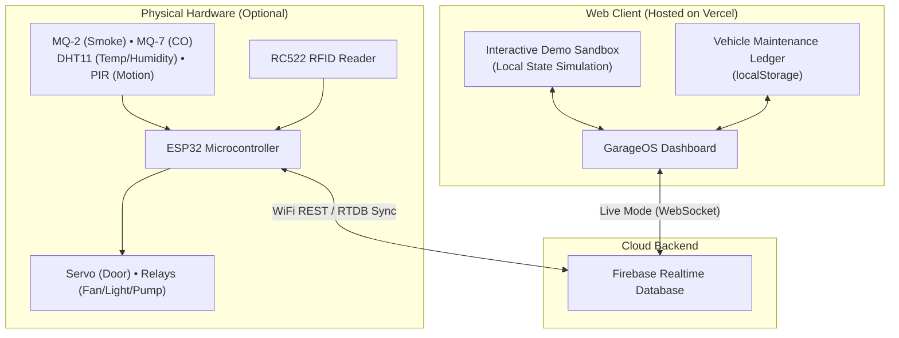

# 🚘 GarageOS — Smart Garage Automation & Vehicle Telemetry Hub

[](https://react.dev)
[](https://firebase.google.com)
[](https://lucide.dev)
[](https://vercel.com)

**GarageOS** is an intelligent garage telemetry, security, and vehicle management platform. Originally developed as an IoT prototype, it has been modernized into a daily driver web application featuring **dual-mode architecture**:
1. **Interactive Demo Sandbox**: Allows recruiters and visitors to simulate real-time sensor triggers, smoke detection, vehicle arrivals, and door toggles directly in the browser with zero hardware setup.
2. **Live IoT Telemetry**: Integrates with physical ESP32 microcontrollers, environmental gas sensors, RFID access gates, and relay actuators via Firebase Realtime Database.

---

## ⚡ Key Highlights & Features

### 1. 🎮 Interactive Simulation Sandbox (Recruiter Friendly)
Visitors to the live demo can test safety and automation interlocks with one-click simulation controls:
- **Vehicle Arrival (PIR)**: Simulates a vehicle pulling up, triggering automatic security lighting and unlocking access.
- **Critical Smoke Spike (MQ-2)**: Simulates fire conditions, immediately activating the automated exhaust ventilation fan and emergency warning banners.
- **Toxic CO Leak (MQ-7)**: Real-time Carbon Monoxide threshold monitoring and safety interlocks.
- **Sump Basin Water Level**: Automated water level sensing with sump pump relay activation.

### 2. 🚪 Animated Garage Bay Controller
- Dynamic CSS shutter door animation providing clear visual feedback on open/locked status.
- Hardware servo lock toggle with status feedback and activity logging.

### 3. 🚗 Daily Driver Vehicle Maintenance Ledger
- **Milestone Countdown**: Track oil changes, tire rotations, brake pad checks, and annual statutory renewals.
- **Dynamic Odometer**: Updates remaining kilometers until required service.
- **Local Persistence**: Service records and vehicle details are preserved across browser sessions via `localStorage`.

### 4. 🛡️ Access Control & Audit Log
- Audit trail tracking RFID card scans (`RC522`), manual overrides, and automated sensor alarms with timestamps and status indicators.

---

## 🏗️ System Architecture



---

## 💻 Tech Stack

- **Frontend**: React 19, Modern CSS Glassmorphism, Lucide Icons
- **Cloud & Telemetry**: Firebase Realtime Database
- **Storage**: Client-side `localStorage` cache with offline fallback
- **Hosting**: Optimized for instant deployment on [Vercel](https://vercel.com)

---

## 🚀 Getting Started Locally

### Prerequisites
- Node.js (v18 or higher)
- npm or yarn

### Installation

1. Clone the repository:
   ```bash
   git clone https://github.com/SasmithaTharushan/smartgarageSystem.git
   cd smartgarageSystem
   ```

2. Install dependencies:
   ```bash
   npm install
   ```

3. (Optional) Set up environment variables:
   ```bash
   cp .env.example .env
   ```
   *Note: If omitted, GarageOS automatically defaults to the interactive simulation mode without errors.*

4. Launch local development server:
   ```bash
   npm start
   ```

5. Build for production:
   ```bash
   npm run build
   ```

---

## ☁️ Deploying to Vercel

1. Push your changes to GitHub:
   ```bash
   git add .
   git commit -m "feat: upgrade to GarageOS with interactive sandbox & vehicle ledger"
   git push origin main
   ```
2. Go to [vercel.com](https://vercel.com) and click **"Add New Project"**.
3. Import `smartgarageSystem` from your GitHub account.
4. Keep the default settings (Framework preset: **Create React App**, Build command: `npm run build`, Output directory: `build`).
5. Click **Deploy** — your live application will be available in less than 2 minutes!

---

## 👤 Author
Developed with ❤️ by **[Sasmitha Tharushan](https://github.com/SasmithaTharushan)**.
